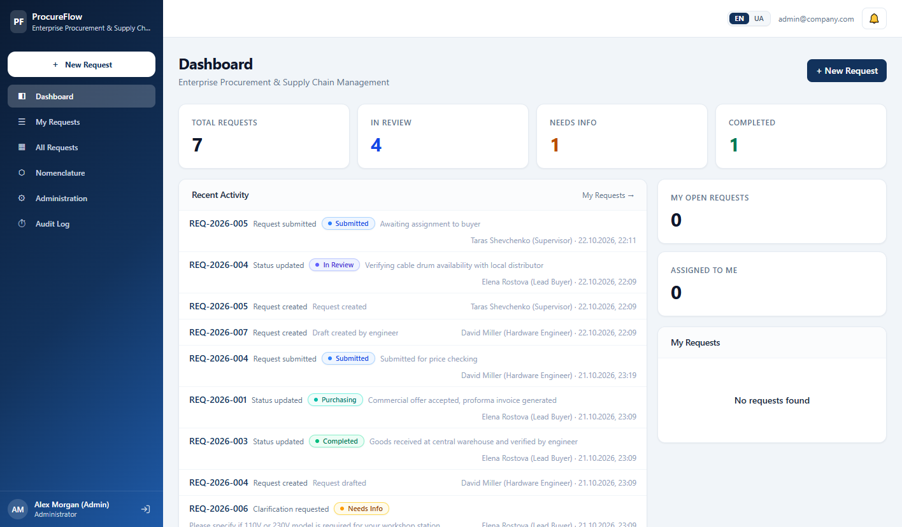
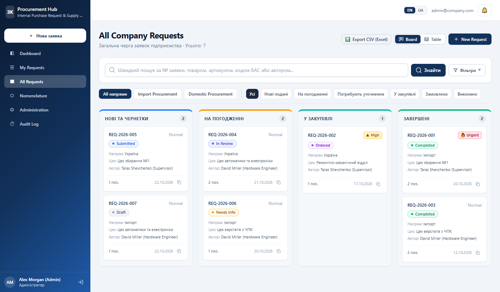
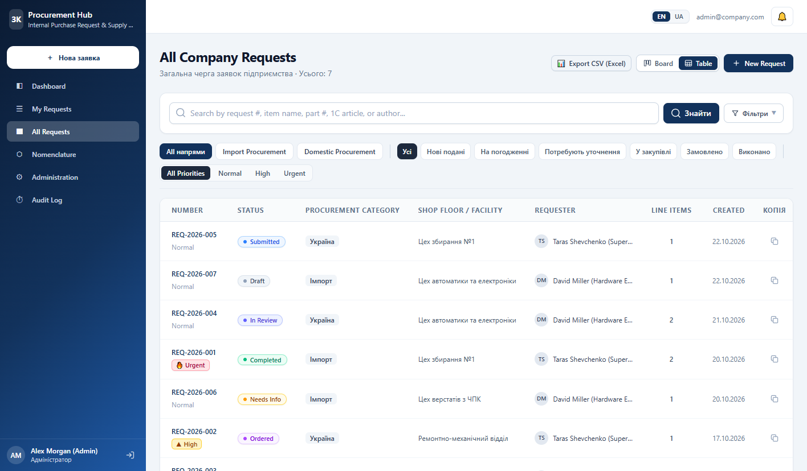
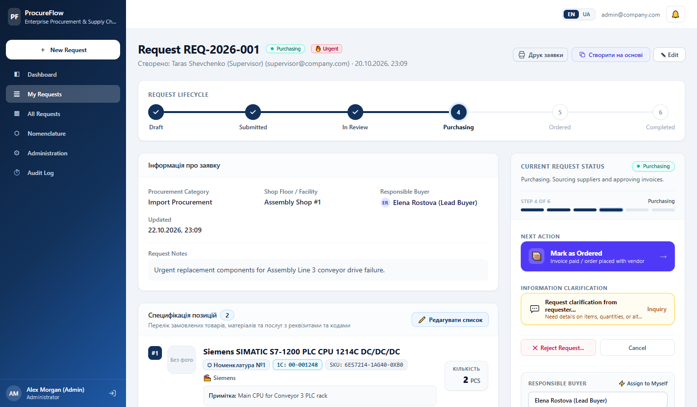
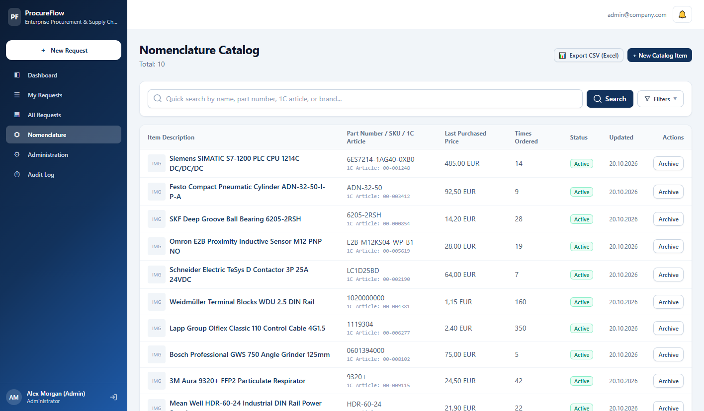
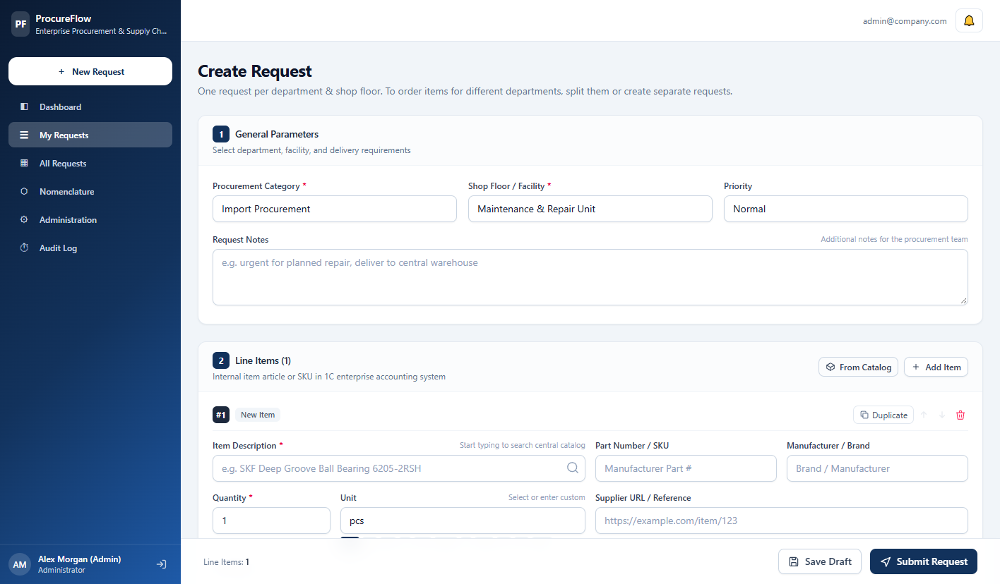
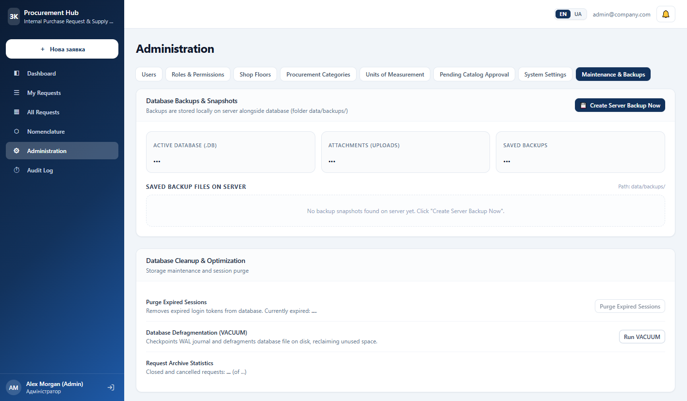

# 📦 ProcureFlow — Enterprise Procurement Management System

<div align="center">

[](https://nextjs.org/)
[](https://react.dev/)
[](https://www.typescriptlang.org/)
[](https://tailwindcss.com/)
[](https://libsql.org/)
[](https://orm.drizzle.team/)
[](LICENSE)

[](https://procureflow.fly.dev/)

**A modern, self-hosted, lightweight internal procurement and supply-chain web system designed for manufacturing plants, engineering workshops, and industrial enterprises.**

[English](README.md) • [Українська](README.uk.md) • [Live Demo](https://procureflow.fly.dev/) • [Quick Start](#-quick-start)

</div>

---

## 🎯 Overview

**ProcureFlow** streamlines the entire internal procurement lifecycle — from an engineer requisitioning a sensor on the shop floor to approval, commercial quotation, supplier PO issuance, and warehouse receipt. 

Unlike bloated enterprise ERPs, ProcureFlow is **blazing fast, lightweight, and requires zero external database servers** (runs on embedded SQLite / LibSQL with automated schema migrations).

### ✨ Core Features

* **Dual View Experience:** Real-time **Kanban Board** with drag-and-drop aesthetics and high-density **Table View** with custom filters, search, and CSV/Excel export.
* **Full Procurement Workflow:** Step-by-step lifecycle (`Draft` → `Submitted` → `In Review` → `Purchasing` → `Ordered` → `Completed`) with clarification loops (`Needs Info`), split orders, and audit trail events.
* **Unified Nomenclature Catalog:** Master item directory with fuzzy duplicate detection, 1C/BAS code integration, part number normalization, manufacturer tracking, and price history.
* **Enterprise RBAC:** Granular role-based permissions (Administrator, Procurement Manager/Buyer, Workshop Lead, Requester/Engineer) with workshop-isolated visibility.
* **Shop-Floor Hardened:** Automatic inactivity session timeout (prevents unauthorized access on shared plant terminals), client-side image compression (WebP), and print-ready requisition specs.
* **1-Click Database Backups:** Hot SQLite backup generation directly from the UI, with immediate download and automated maintenance tools.
* **Centralized Enterprise Localization:** Full bilingual support (`EN` / `UK`). Deployment environment variable (`DEFAULT_LOCALE`) + dynamic Admin panel setting (`System Settings` → `System Language`) that instantly sets the language for all users across the company without altering database tables.
* **Smart Real-time Sync & SSE:** Lightweight Server-Sent Events (`ENABLE_REALTIME=true`) push instantaneous update notices without brute-force page reloads, paired with an explicit manual "Refresh" control and graceful degradation for serverless platforms.
* **Security First:** `HttpOnly` SameSite sessions, Google OAuth 2.0 with corporate domain fencing (`@company.com`), CSRF/idempotency protection against double clicks, Magic-Byte MIME verification, and stealth `noindex` headers.

---

## 📸 Screenshots Showcase

### 1. Operations Dashboard
> High-level KPIs, request distribution by procurement categories, status charts, and recent team activity feed.


---

### 2. Kanban Board & Table Views
> Visual pipeline columns organized by procurement status with quick-action cards, urgency badges, and instant view switcher.


> Dense tabular view with multi-column filtering, date ranges, and 1-click Excel/CSV export.


---

### 3. Requisition Details & Workflow Execution
> Visual lifecycle stepper, item specifications with pricing, supplier comments, and role-based action panel.


---

### 4. Nomenclature Master Catalog
> Clean search, 1C/BAS ERP synchronization codes, duplicate detection algorithms, and usage analytics.


---

### 5. Fast Bulk Request Creation
> Multi-line item addition, rapid catalog picker, price estimation, and client-side photo attachments.


---

### 6. Administration & 1-Click Backups
> System health, user & role management, directory configuration, and single-click zero-downtime database backups.


---

## 🚀 Quick Start

### Prerequisites
* [Node.js](https://nodejs.org/) v20.x or newer (v22 LTS recommended).
* No external database needed (SQLite database file initializes automatically at `./data/procurement.db`).

### 1. Clone & Install
```bash
git clone https://github.com/your-username/procurement-management-system.git
cd procurement-management-system
npm install
```

### 2. Seed Realistic Demo Data (Optional but Recommended)
Populates the database with realistic industrial equipment, workshops, departments, and sample orders across all statuses:
```bash
npm run seed
```

### 3. Start Development Server
```bash
npm run dev
```
Open **[http://localhost:3000](http://localhost:3000)** in your browser.

---

## 🔑 Demo Accounts & Authentication

ProcureFlow uses **passwordless authentication exclusively via Google OAuth 2.0 (Gmail / Google Workspace)**. There are no login/password credentials.

* **Production Mode:** Users click **"Sign in with Google"** and authenticate with their corporate Gmail or Google Workspace account.
* **Local / Demo Mode:** When Google OAuth keys (`GOOGLE_CLIENT_ID` / `GOOGLE_CLIENT_SECRET`) are not yet configured in `.env`, the login page automatically displays **1-click Google emulator buttons** for each role:

| Role | Corporate Email (Google) | Access Level | Description |
| :--- | :--- | :--- | :--- |
| **Administrator** | `admin@company.com` | Full Admin | System settings, user activation, audit, backups |
| **Procurement Manager (Buyer)** | `buyer@company.com` | Buyer | Quotations, supplier orders, requisitions processing |
| **Shop Manager (Supervisor)** | `shop@company.com` *(or `supervisor@company.com`)* | Workshop Master | Assembly shop requisitions & approvals |
| **Hardware Engineer (Requester)** | `requester@company.com` *(or `engineer@company.com`)* | Requester | New requisition drafting & item specs |

---

## 🐳 Docker Deployment

The application includes an optimized multi-stage `Dockerfile` (`output: "standalone"`) and an automated `docker-entrypoint.sh` startup script.

### Run with Docker Compose:
```bash
docker compose up -d --build
```
Your instance will be available at `http://localhost:3000` with persistent storage mounted in Docker volumes (`procurement-data` and `procurement-uploads`).

* **Automated First-Run Seeding:** If the database volume is empty, the container automatically initializes the schema and loads realistic demo data.
* **Force Reset Demo:** Set `SEED_DEMO=true` in `docker-compose.yml` to automatically wipe and re-seed clean demo data on restart.

---

## 🌐 Live Demo

A live public demo instance is running at:
👉 **[https://procureflow.fly.dev/](https://procureflow.fly.dev/)**  
*(Mirror backup on Render: [procureflow-jcea.onrender.com](https://procureflow-jcea.onrender.com/))*

> [!NOTE]
> The demo runs on Fly.io (Frankfurt region, 1 GB RAM) with single-digit millisecond SQLite response times.
> Pre-configured demo accounts (**Administrator**, **Buyer**, **Shop Manager**, **Requester**) are available directly on the sign-in page with 1-click login.

---

## ⚙️ Environment Configuration (`.env`)

Copy `.env.example` to `.env` and adjust the variables as needed:

```env
# Database (Local SQLite file or Turso libsql:// URL)
DATABASE_URL=file:./data/procurement.db
DATABASE_AUTH_TOKEN=

# Default interface language: "en" (English) or "uk" (Ukrainian)
DEFAULT_LOCALE=en

# Secure upload directory for attachments
UPLOAD_DIR=./var/uploads

# Base Application URL
APP_URL=http://localhost:3000
NEXT_PUBLIC_APP_URL=http://localhost:3000

# Public Live Demo Safety Mode (Optional)
# Set to "true" on public demo hosting to limit backups to max 2 files and enforce a 60s cooldown
DEMO_MODE=false
# ALLOW_DATABASE_BACKUPS=false  # Set to false to completely disable backup creation in demo
# MAX_BACKUPS_COUNT=10          # Maximum retained backups on server (FIFO auto-prune)

# Google OAuth 2.0 (Optional)
GOOGLE_CLIENT_ID=
GOOGLE_CLIENT_SECRET=

# Restrict sign-in to verified corporate email domain (e.g. company.com)
CORPORATE_EMAIL_DOMAIN=

# Security, Geoblocking & VPN
# Modes: "off" (default for dev) | "cloudflare" | "nginx" | "standalone"
GEO_RESTRICT_MODE=off
ALLOWED_COUNTRIES=UA,US,PL,DE,GB
BLOCK_VPN=false

# Outgoing SMTP Notifications (Optional)
# Leave SMTP_HOST blank to output email logs directly to the server console
SMTP_HOST=
SMTP_PORT=587
SMTP_SECURE=false
SMTP_USER=
SMTP_PASS=
SMTP_FROM=Procurement System <noreply@procurement.local>
```

### Gmail / Google Workspace SMTP Setup:
To send automated notification emails through a Gmail account:
1. Enable **2-Step Verification** in your Google Account.
2. Go to **[App Passwords](https://myaccount.google.com/apppasswords)**.
3. Generate a 16-character code for `Procurement System`.
4. Configure in `.env`:
   ```env
   SMTP_HOST=smtp.gmail.com
   SMTP_PORT=465
   SMTP_SECURE=true
   SMTP_USER=your-email@company.com
   SMTP_PASS=xxxx xxxx xxxx xxxx
   SMTP_FROM=Procurement System <your-email@company.com>
   ```

---

## 🏗️ Architecture & Security Principles

```
 ┌────────────────────────────────────────────────────────┐
 │                   Next.js 16 Client                    │
 │    (App Router, Server Actions, React 19, i18n)        │
 └──────────────────────────┬─────────────────────────────┘
                            │  Encrypted HttpOnly Cookies
                            ▼
 ┌────────────────────────────────────────────────────────┐
 │               Next.js Edge / Node Server               │
 │  ┌─────────────────┐ ┌───────────────┐ ┌─────────────┐ │
 │  │ Geo & Bot Shield│ │ Auth & RBAC   │ │ Audit Log   │ │
 │  │ (noindex / VPN) │ │ (Session Ttl) │ │ Middleware  │ │
 │  └─────────────────┘ └───────────────┘ └─────────────┘ │
 └──────────────────────────┬─────────────────────────────┘
                            │  Parameterized Prepared SQL
                            ▼
 ┌────────────────────────────────────────────────────────┐
 │           Drizzle ORM & LibSQL Client Engine           │
 │  ┌──────────────────────────────────────────────────┐  │
 │  │  SQLite Local Database (`data/procurement.db`)   │  │
 │  │  or Hosted Cloud LibSQL Database (Turso)         │  │
 │  └──────────────────────────────────────────────────┘  │
 └────────────────────────────────────────────────────────┘
```

* **Server-Only Isolation:** All database clients, schema declarations, and business algorithms are guarded with `import "server-only"`. No secret keys or query logic leak into client bundles.
* **SQL Injection Immunity:** 100% of queries use Drizzle ORM's parameterized statements.
* **Stealth Indexing Block:** Full 3-layer protection against crawlers: `X-Robots-Tag: noindex, nofollow`, `robots.txt`, and HTML meta tags.
* **Magic-Byte File Inspection:** Uploaded attachments are inspected by binary header bytes to prevent disguised executables.
* **Idempotency Protection:** Requisition form submissions use transient idempotency tokens to eliminate duplicate orders from double-clicking.

---

## 🛠️ Code Quality & Maintenance

```bash
# Run TypeScript compilation check
npm run typecheck

# Run ESLint validation
npm run lint

# Build production bundle
npm run build

# Re-seed clean demo database
npm run seed
```

---

## 📄 License

This project is open-source software licensed under the [MIT License](LICENSE).
